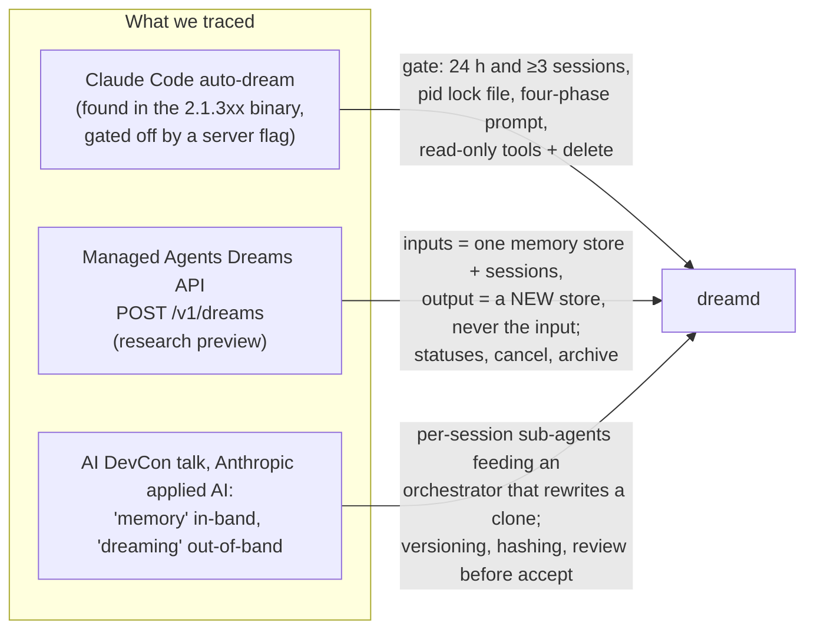
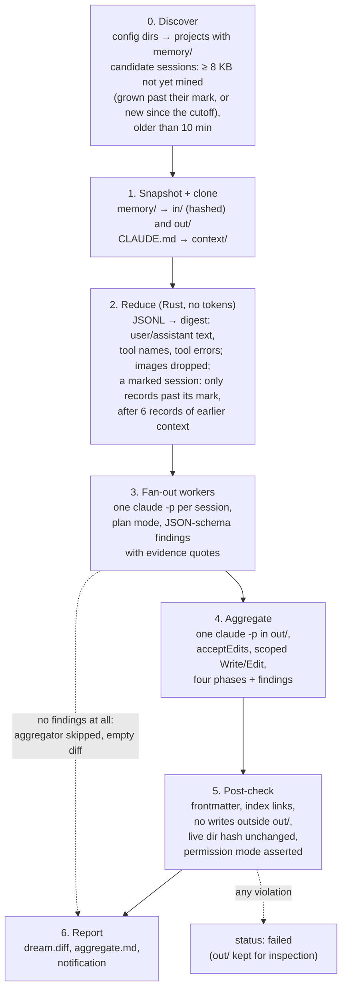
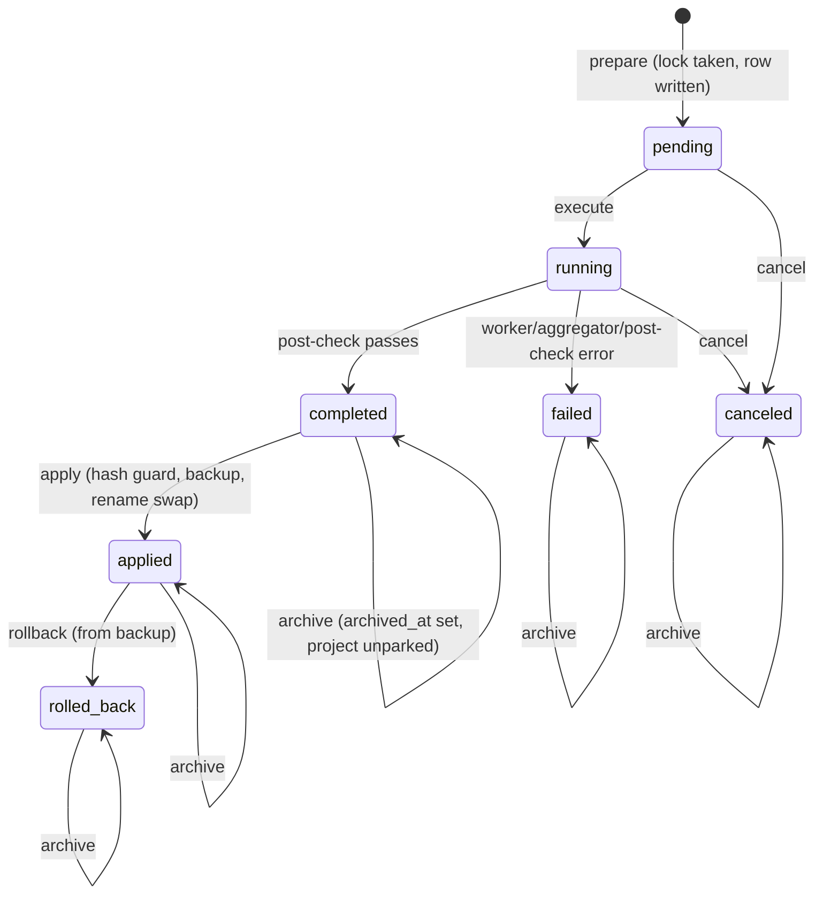
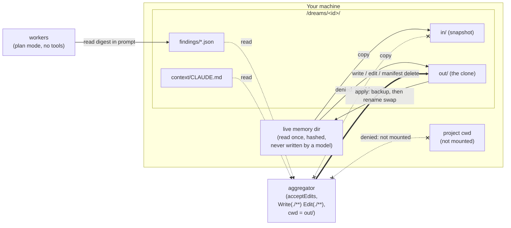
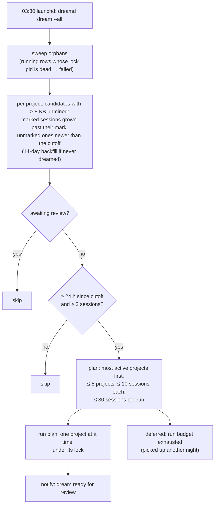

# dreamd: where it came from and how it works

dreamd is a local, out-of-band memory consolidator for Claude Code. It was built on 2026-11-02 after
tracing three sources: the dormant auto-dream code inside the Claude Code binary, Anthropic's hosted
Dreams API for Managed Agents, and an Anthropic talk on memory systems. This document frames the design
against those sources and explains each moving part with a diagram.

## 1. Three sources, one shape

**From the binary.** Claude Code already ships a `DreamTask`. It fires after a turn when at least
24 hours and a few sessions have passed, takes a `.consolidate-lock` whose mtime is the last run and whose
content is the owning pid, forks a subagent with a read-only shell plus permission to delete memory
`.md` files, and walks four phases: skim, merge duplicates, prune stale, reconcile against CLAUDE.md
without editing it. It is switched off for this account by a feature flag, which is the whole reason
dreamd exists. dreamd keeps the gate, the lock semantics and the four phases almost verbatim.

**From the hosted API.** A hosted dream takes one memory store and 1 to 100 session transcripts and
writes a *new* store; the input is never modified, the caller reviews and then attaches or discards.
dreamd copies that contract exactly: `in/` is a snapshot, `out/` is the clone the aggregator edits,
and `apply` is a separate, explicit, reversible step. The status set (pending, running, completed,
failed, canceled) and the cancel and archive verbs are the same words.

**From the talk.** The speaker split memory into an in-band process (the agent writes notes while
working) and an out-of-band "dreaming" pass with its own token budget and fleet-wide visibility, run as
an orchestrator spawning one sub-agent per transcript, with the production guardrails of versioning,
content hashing before writes, and human acceptance of proposed changes. That is dreamd's fan-out and
fan-in, the hash guard on apply, and the review loop.

## 2. The pipeline

The only steps that spend tokens are 3 and 4. Everything else is Rust, which is what keeps a nightly
run cheap and deterministic. Reading is incremental: a completed dream records, per session whose worker
succeeded, the byte offset and record count its digest consumed (`session_marks`), so a long-lived
session that keeps growing is read from that mark (the new records, plus up to 6 earlier user/assistant
text records marked "already consolidated") instead of from byte 0, and a session that did not grow is
not read at all. When no worker found anything, step 4 is skipped and the dream completes with an empty
diff. Workers see a digest, not a raw transcript, and must cite a session id and
a quote for every insight; the aggregator is told to add a memory only when a findings file backs it.

## 3. The review loop and dream lifecycle

A `completed` dream parks its project as *awaiting review* until it is applied, rolled back or
archived. Completion also advances the project's mining cutoff, so a nightly run never re-mines the
same sessions, and `--force` is the deliberate way around both.

## 4. Who may write where

The first version used `bypassPermissions` and mounted the project directory. A live probe showed the
aggregator could then write anywhere, so containment moved to the front: `acceptEdits` with a scoped
allowlist, no Bash, deletions through a validated manifest, CLAUDE.md copied in rather than mounted,
and a runtime assertion that the session really ran in that mode. The account-rotating `claude`
wrapper injects `--dangerously-skip-permissions`, so dreamd refuses it and runs the real binary.

## 5. The nightly gate and caps

Measured on this machine, an uncapped first run would have mined 381 sessions. Under the defaults it
mines 30 and touches the 3 or 4 most active projects, and because completion advances the cutoff and
parks the project, the following nights only see new work: a session is a candidate again only when it
grew by at least `min_transcript_bytes` past its mark, and then only that growth is read.

## 6. What was deliberately left out

Team memory, editing CLAUDE.md, auto-apply by default, a web UI, and dreaming hosted memory stores.
Each is a real feature in one of the sources; none is needed to close the loop locally, and the first
three carry risk that the review step is there to prevent.
